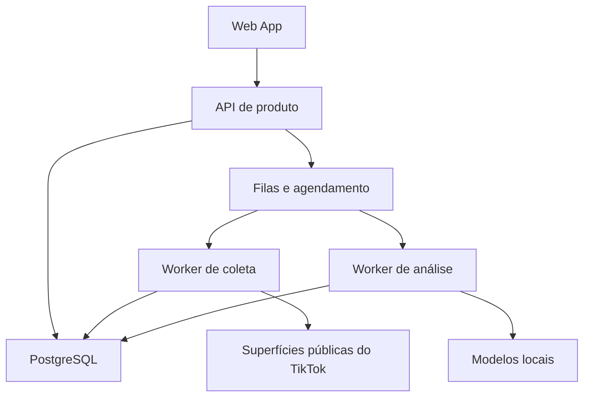
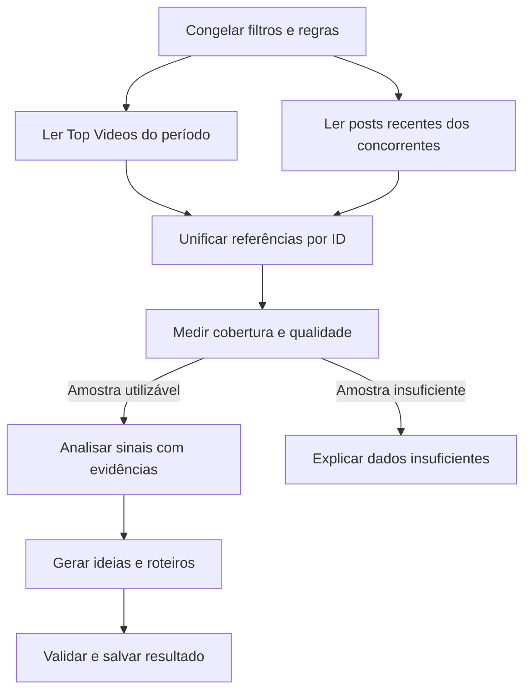

# Pulso · SaaS de inteligência de conteúdo viral para TikTok

**Versão 1.3 · Especificação funcional, interface e arquitetura · Novembro de 2026**

## 1. Produto e escopo

A plataforma ajuda criadores, equipes de marketing e agências a descobrir vídeos em alta por país e nicho, acompanhar criadores de referência e transformar padrões observados em ideias e roteiros originais. O scraper usa o **Brasil (BR)** como país padrão. O usuário pode selecionar **qualquer país** como recorte da busca. A interface usa português e o fuso America/Sao_Paulo como padrões. Todos os instantes são armazenados em UTC.

| Área | Entrega |
|---|---|
| Top Videos | Feed com pelo menos 20 vídeos distintos quando houver cobertura elegível, períodos Dia, Semana e Mês, seletor de país, filtro de hashtag gerado a partir dos vídeos carregados, métricas e links. |
| Creators | Adicionar e remover referências por usuário ou URL. Navegar entre vídeos recentes e mais performáticos. |
| Brand Rules | Configuração opcional de categoria para a coleta, público-alvo, elementos de análise, formato preferido, tom e diretrizes. |
| Run Pipeline | Combinar concorrentes e Top Videos, extrair sinais, produzir ideias e roteiros, e mostrar a evidência de cada conclusão. |

**Definição de cobertura.** O produto exibe o ranking dos vídeos que observou e conseguiu classificar. Um ranking exaustivo de todo o TikTok, a presença garantida de 20 vídeos para qualquer filtro e a atualização contínua de um serviço externo não são verificáveis com os coletores estudados. A meta é carregar 20 vídeos elegíveis por consulta de base. O filtro de hashtag pode exibir um subconjunto menor. Qualquer país pode ser selecionado desde o lançamento. Quando a coleta ainda estiver em andamento, a cobertura for insuficiente ou a fonte estiver indisponível, o serviço informa o estado e mostra apenas a quantidade real de resultados do recorte escolhido.

### 1.1 Referência de interface

O [frame interativo do Pulso](https://chatgpt.com/library?file_id=libfile_1f9fa4de2d4c819196f2d766a5b2960b&account_id=personal), revisão 7, é a referência visual do MVP. Usá-lo para reproduzir os nomes dos controles, a hierarquia das informações, a disposição das telas e as interações descritas nesta especificação. Thumbnails ilustrativas, nomes, contadores, datas, evidências, roteiros e análise visual de exemplo pertencem à demonstração. Em produção, os resultados vêm das fontes e do processamento descritos aqui. A cobertura demonstrativa de Brasil e Portugal não restringe o seletor de países. A persistência local e o progresso simulado do frame representam, respectivamente, armazenamento no workspace e execução assíncrona no backend.

| Tela na navegação | Estrutura de interface e ações esperadas |
|---|---|
| **Vídeos em alta** | Cabeçalho com **Analisar recorte**. Barra com **País**, **Período** (Dia, Semana, Mês), **Hashtag** e **Limpar filtros**. Mostrar **Categoria da marca** e **Editar categoria** junto aos filtros. Abaixo, contexto e horário do **Ranking por crescimento**, cobertura da consulta, cards e navegação entre páginas. |
| **Criadores** | Lista **Perfis salvos** e painel **Vídeos do perfil**. **Adicionar perfil** aceita usuário ou URL. Cada perfil tem **Ver vídeos** e **Remover**. Após remover, oferecer **Desfazer** no painel. No painel do perfil, alternar **Recentes** e **Mais performáticos**. |
| **Regras da marca** | Seção **Público e direção** com **Categoria (opcional)** em texto livre, acima de **Público-alvo**, seguida de **Tom de voz** e **Diretrizes da marca**. Seção **Roteiro e análise** com **Formato preferido** e seleção de gancho, estrutura do roteiro, CTA, ritmo, texto na tela, duração e retenção. Rodapé com **Descartar alterações**, **Limpar campos** e **Salvar regras**. |
| **Gerar ideias** | Painéis **Configuração da análise** e **Progresso**. A configuração mostra recorte, vídeos, perfis, regras aplicadas e total de referências elegíveis. Ações **Ajustar filtros** e **Iniciar análise**. Após iniciar, mostrar **Cancelar execução**. Ao terminar, exibir **Ideias e roteiros**, com **Copiar roteiro**, **Exportar JSON** e **Ver vídeo de referência** em cada ideia da análise geral. |

### 1.2 Comportamentos transversais de interface

- **Hierarquia e responsividade.** Uma ação principal clara por tela. Em telas largas, navegação lateral e painéis lado a lado, conforme o frame. Em telas estreitas, navegação e painéis empilhados, filtros com largura suficiente, métricas em duas colunas quando o card não comportar quatro e ações sem rolagem horizontal. A aparência preserva as superfícies claras, navegação e faixa de ranking escuras e destaque violeta para controles primários.
- **Teclado e contraste.** Manter foco visível, rótulos explícitos, navegação ativa identificável sem depender só da cor e feedback de estado acessível. Janelas de detalhes e ideias usam superfície opaca clara e texto escuro de alto contraste, com fechamento por botão e Escape e retorno de foco ao controle de origem. Respeitar movimento reduzido. O navegador deve permitir voltar entre as telas sem apagar alterações de formulário durante a navegação interna.
- **Estados de dados.** Distinguir coleta em andamento, cobertura parcial, recorte sem resultados e fonte indisponível. Um filtro aplicado que reduz a quantidade visível mostra a contagem filtrada separada da cobertura da consulta. Métricas faltantes aparecem como indisponíveis. Ações apresentam uma forma de recuperação, como editar categoria, trocar país ou período, ou aguardar a coleta.
- **Preferências e rascunho.** Salvar o último país escolhido para a próxima visita. O comando **Limpar filtros** volta a Brasil, Dia e Todas as hashtags. A categoria salva continua valendo. Nas Regras da Marca, indicar alterações não salvas e preservar o rascunho ao trocar de área na navegação interna. **Limpar campos** altera o rascunho. **Descartar alterações** restaura a última versão salva. **Salvar regras** publica a configuração, inclusive a remoção da categoria quando o campo é salvo vazio.
- **Rastreabilidade.** Cada rodada geral congela país, período, categoria, hashtag, fontes e regras ao iniciar. Se os filtros mudarem depois, os resultados existentes continuam associados ao recorte original, com a opção **Analisar recorte atual** para iniciar outra rodada.

## 2. Coletor selecionado e pesquisa

**Seleção para o MVP: `davidteather/TikTok-Api`**, biblioteca Python de código aberto sob licença MIT. O adaptador inicial integra três rotas documentadas: feed de recomendações para descobrir candidatos em alta, publicações de hashtag para formar amostras por tema e publicações por perfil para acompanhar concorrentes. A integração Python se encaixa no backend e permite usar a mesma normalização em todas as fontes. O coletor depende do Playwright e da disponibilidade das superfícies públicas consultadas. [Repositório](https://github.com/davidteather/TikTok-Api) · [Trending](https://github.com/davidteather/TikTok-Api/blob/main/TikTokApi/api/trending.py) · [Hashtags](https://github.com/davidteather/TikTok-Api/blob/main/TikTokApi/api/hashtag.py) · [Perfis](https://github.com/davidteather/TikTok-Api/blob/main/TikTokApi/api/user.py)

| Candidato | Manutenção e adoção observadas | Cobertura e decisão |
|---|---|---|
| **TikTok-Api** | **~6,8 mil estrelas** no GitHub. Versão **7.3.5**, publicada em **14/11/2026** no PyPI. | Reúne recomendações, hashtags e perfis com uma interface Python. Candidato principal. A recomendação é uma fonte de descoberta, pois não expõe filtro documentado por categoria ou país nem garante volume. [GitHub](https://github.com/davidteather/TikTok-Api) · [PyPI](https://pypi.org/project/TikTokApi/) |
| **Evil0ctal/Douyin_TikTok_Download_API** | **~21,5 mil estrelas**. Notas de versão registram mudanças de coleta em novembro de 2026. Licença Apache 2.0. | Boa cobertura de posts, perfis, hashtags e comentários. A matriz do projeto marca ranking de tendências como indisponível no TikTok. A busca de posts por palavra-chave exige sessão autenticada. Operar um segundo serviço completo aumentaria a complexidade do MVP. [GitHub](https://github.com/Evil0ctal/Douyin_TikTok_Download_API) · [Releases](https://github.com/Evil0ctal/Douyin_TikTok_Download_API/releases) |
| **dfreelon/pyktok** | **468 estrelas**. Última versão localizada no PyPI: **0.0.31**, de **21/02/2025**. Licença BSD-3-Clause. | Útil para CSV, lista de links e pequenas amostras por hashtag ou perfil. O pacote depende do próprio TikTok-Api, o que limita seu valor como redundância independente. [GitHub](https://github.com/dfreelon/pyktok) · [Dependências](https://github.com/dfreelon/pyktok/blob/main/pyproject.toml) · [PyPI](https://pypi.org/project/pyktok/) |

A escolha prioriza cobertura funcional, documentação e manutenção recente. Estrelas aproximam adoção, enquanto estabilidade e segurança exigem validação separada. Antes de aprovar a versão em produção, fixar a revisão e as dependências com hashes, revisar código e árvore de dependências, executar auditoria de vulnerabilidades e testar em contêiner sem privilégios. A pesquisa verificou documentação e releases. O coletor não foi executado nesta entrega.

**Condições de uso e viabilidade comercial.** Coletar somente dados públicos e executar a coleta em produção após confirmar que o acesso automatizado e os usos planejados estão autorizados pelos termos aplicáveis ou por permissão documentada. A captura arquivada consultada inclui restrição à extração automatizada sem aprovação. A versão regional oficial não pôde ser recuperada diretamente nesta pesquisa. Confirmar os termos aplicáveis aos mercados atendidos, a finalidade comercial, as regras de exibição de thumbnails, a retenção e a redistribuição antes do lançamento. A Research API exige elegibilidade e finalidade de pesquisa não comercial nas condições consultadas, portanto ela não é a base deste SaaS. [Termos do TikTok](https://www.tiktok.com/legal/page/row/terms-of-service/pt-BR) · [Captura dos termos](https://github.com/OpenTermsArchive/pga-versions/blob/main/TikTok/Terms%20of%20Service.md) · [Research API](https://developers.tiktok.com/products/research-api/)

## 3. Arquitetura e stack

| Camada | Stack recomendada | Responsabilidade |
|---|---|---|
| Frontend | Next.js, TypeScript e Tailwind CSS | Quatro áreas do produto, filtros na URL, estados vazios e parciais, cards acessíveis e acompanhamento do Run. |
| Backend | FastAPI, Pydantic, SQLAlchemy e Alembic | API REST, validação, tenancy, contratos, ranking e migrações. |
| Dados e tarefas | PostgreSQL, Celery e RabbitMQ | Banco durável para dados e jobs, fila para execução assíncrona e agendador único. Separar filas de coleta, classificação, análise multimodal e geração. |
| Coleta | TikTok-Api e Playwright em worker isolado | Descoberta, leitura de perfis, enriquecimento, validação e normalização. Um adaptador interno impede acoplamento da UI ao scraper. |
| Inteligência | Regras/versionamento, Ollama com modelo local de saída JSON, FFmpeg, Whisper e OCR local | Classificação inicial com metadados. Transcrição, duração real, frames e texto na tela dependem de mídia autorizada e acessível. Validar licença dos pesos antes de implantar. [Saídas estruturadas do Ollama](https://docs.ollama.com/capabilities/structured-outputs) |
| Operação | Docker Compose no piloto, OpenTelemetry, Prometheus e Grafana | Implantação inicial, logs, métricas, alertas, backups e recuperação. Escalar os workers por fila quando necessário. |

Um monólito modular atende o MVP. O frontend lê o banco por meio da API. Novas consultas usam rankings materializados e a atualização ocorre em background. A execução reaproveita dados públicos entre workspaces quando o uso estiver autorizado. Favoritos, regras e roteiros pertencem ao workspace que os criou. A IA recebe dados normalizados com IDs de origem e sem credenciais. Processamento e infraestrutura podem ter custos, embora o coletor e a stack selecionados dispensem assinatura de scraping.

## 4. Top Videos

1. Ao abrir o feed, usar o país salvo ou `BR`, período Dia e a **Categoria** salva nas **Regras da Marca**, quando definida. Sem categoria salva, descobrir todos os vídeos em alta identificados no país ativo dentro da cobertura disponível, inclusive os que ainda não têm categoria atribuída. O seletor lista todos os países do catálogo ISO 3166-1 alfa-2. Trocar o país atualiza a consulta de base e o recorte do Run Pipeline, mantendo a categoria da marca e o período. Se não houver ranking para a consulta, solicitar coleta assíncrona deduplicada e indicar o estado no feed. Dia, Semana e Mês usam janelas móveis de 24 horas, 7 dias e 30 dias. Exibir os limites do período e a última atualização.
2. Gerar candidatos em background com recomendações, hashtags de descoberta curadas e perfis de referência autorizados. Com categoria salva, priorizar fontes dessa categoria. Sem categoria, usar fontes variadas no país ativo, sem restringir a coleta a um nicho. As hashtags de descoberta servem para localizar candidatos. As opções do filtro de Hashtag derivam somente dos vídeos efetivamente carregados. Deduplicar por ID, registrar origem, horário e versão do adaptador, e atualizar contadores para medir crescimento.
3. Inferir categorias pelo texto da legenda, hashtags e, quando disponível, transcrição. Usar a taxonomia versionada como referência para classificação. Normalizar o texto digitado para busca e comparação, preservando o texto original para exibição. Para um termo fora do catálogo, usar o próprio nicho informado para descobrir e classificar candidatos. Se o recorte não tiver vídeos elegíveis, exibir o estado sem resultados e manter a categoria escolhida. Um vídeo pode ter mais de uma categoria. No piloto, admitir rótulos revisados ou confiança a partir de 0,80, calibrada com amostra humana. Quando houver categoria salva nas Regras da Marca, o vídeo precisa de uma associação válida a ela para entrar na consulta de base.
4. Atribuir sinais geográficos documentados. Usar país declarado por fonte quando disponível, ou inferência a partir de evidências explícitas de origem pública, como localização declarada pelo próprio criador e referências locais consistentes. A seleção de país no produto não cria evidência geográfica. Idioma, hashtag ampla, perfil acompanhado ou IP isolado são insuficientes para validar a associação com o país escolhido. Excluir país incerto do filtro estrito. Informar ao usuário se o recorte é de origem observada ou inferida. Métricas exibidas são totais globais do post, pois o scraper não fornece views por país do espectador.
5. Aplicar país, período e categoria salva, quando houver, antes de ranquear. Carregar 20 vídeos por consulta/página quando houver 20 elegíveis, com cursor ligado à versão do ranking. Se houver 17 elegíveis, carregar os 17 com `partial_coverage`. A interface pode oferecer mudança de país ou período, edição da categoria nas Regras da Marca ou aguardar atualização.
6. **Filtro Hashtag.** Gerar as opções a partir das hashtags dos vídeos já carregados na consulta de base, incluindo páginas adicionais já carregadas. Usar o conjunto anterior à aplicação do filtro, normalizar e deduplicar as tags e preservar seu rótulo de exibição. Mostrar **Todas as hashtags** como opção inicial. Selecionar uma tag exibe apenas vídeos carregados com aquela hashtag, na ordem original do ranking. A seleção não dispara nova coleta. Se a consulta de base mudar, reconstruir as opções e manter a hashtag selecionada apenas se ela ainda existir. Quando não houver tags, manter todos os vídeos carregados visíveis e indicar que o filtro está indisponível. Exibir a contagem após o filtro separadamente da cobertura da consulta de base.
7. Cada card mostra thumbnail ou placeholder, legenda como descrição, criador, views, likes, comentários, shares, data de publicação, hashtags principais, link original e horário da observação. Preservar campo desconhecido como nulo e exibir “Indisponível”. Guardar separadamente a data de publicação e os horários das medições. Um link original indisponível recebe estado próprio.

### 4.1 Card e ações do vídeo

O card apresenta posição no ranking, miniatura, descrição, criador, crescimento no período, métricas acumuladas, publicação e hashtags. O número da posição permanece o mesmo ao refinar por hashtag. Em paginação, o feed mantém os dados já carregados que servem de base para o seletor. A ação **Carregar mais vídeos** pode ampliar essa base quando houver nova página do mesmo ranking. Selecionar uma hashtag não solicita coleta.

| Ação do card | Destino e comportamento |
|---|---|
| **Ver detalhes** | Abre janela com informações do vídeo, incluindo data de publicação, hashtags, país, crescimento no período e distinção entre valores acumulados e de janela. Permite abrir o link original ou acessar **Ideias e roteiros**. |
| **Ver no TikTok** | Abre o link original em uma nova aba quando disponível. Se indisponível, informar a condição. |
| **Ideias e roteiros** | Abre uma janela para o vídeo do card, diretamente sobre o feed. Mostra o vídeo e criador no topo e oferece **Roteiro** e **Análise visual**. A produção de um roteiro individual usa esse vídeo como única referência inicial. |

### 4.2 Critério de viralidade

Dentro de cada janela, selecionar a primeira e a última medição válidas de cada vídeo. Calcular `delta_views = views_final − views_inicial` e `velocidade = delta_views / horas_observadas`. Exigir amostras comparáveis e publicar uma cobertura mínima inicial de 75% do período, com última medição dentro da meta de atualização. Vídeos publicados dentro da janela entram por velocidade desde a primeira medição, com observação mínima de duas horas no Dia e 12 horas na Semana/Mês, e recebem o selo “Janela parcial”. No ranking principal, a ordenação usa velocidade com desempate por delta, observação mais recente e ID. Identificar comparação entre janelas completas e parciais na interface. Começar com regras explícitas e calibrar com o piloto.

- Queda anômala de contador gera quarentena para aquele par. O cálculo aguarda observações válidas.
- Curtidas, comentários e shares por mil views são métricas auxiliares. Calcular apenas quando o denominador for positivo e os contadores envolvidos existirem. Se usar crescimento de engajamento, alinhar as mesmas datas ao delta de views.
- Sem duas medições válidas, oferecer uma seção “Mais vistos da amostra” por views acumuladas, claramente identificada. Ela não compõe o Top Videos por crescimento nem preenche artificialmente o mínimo de 20. Em um ambiente novo, as janelas longas acumulam histórico com o tempo.

## 5. Creators

1. O usuário adiciona `@perfil` ou URL do TikTok. A API valida o formato, resolve o perfil público e guarda seu ID de plataforma como chave estável. Mostrar prévia com nome e avatar antes da confirmação, quando disponíveis. Na ausência de resposta, exibir estado pendente e permitir cancelar.
2. Salvar vínculo único por workspace e criador. A busca inicial coleta uma amostra recente e guarda os IDs encontrados. O agendador atualiza o perfil e os contadores dos seus posts em intervalos ajustáveis. Vários workspaces acompanhando a mesma referência reaproveitam a mesma coleta pública.
3. Aba **Recentes** ordena por publicação. Aba **Mais performáticos** usa a velocidade no período e oferece visualização por total de views como ordenação distinta. Exibir período analisado e atualização. Para medir desempenho relativo ao próprio canal, mostrar percentil ante uma amostra mínima de dez posts comparáveis, quando houver.
4. Ao remover, desativar o vínculo e preservar os runs históricos do workspace conforme a política de retenção. Interromper atualizações exclusivas se o perfil já não estiver em nenhuma lista ou fonte ativa. Mostrar estados públicos indisponíveis, conta privada, acesso bloqueado e dados desatualizados sem insistir no acesso. O feedback apresenta **Desfazer**, que restaura o vínculo sem obrigar a pesquisar o perfil novamente. Exibir falha recuperável se remover ou restaurar não for confirmado pelo servidor.

## 6. Configs / Brand Rules

A configuração é opcional. A **Categoria** salva nas Regras da Marca define o nicho da próxima coleta e consulta de base. Ao limpar esse campo e salvar, o produto volta a descobrir vídeos em alta de todos os nichos no país ativo, dentro da cobertura disponível. Sem país selecionado ou preferência salva, o scraper usa BR. O filtro **Hashtag** em Top Videos refina os resultados carregados. Definir regras por patch e versionar cada revisão. Atribuir ao Run a versão selecionada para reprodução futura.

| Campo opcional | Como entra no fluxo |
|---|---|
| Categoria | Campo de texto livre e opcional usado na descoberta e na elegibilidade do ranking de base. O usuário digita o nicho, como Fitness, culinária vegana ou educação financeira. O sistema aceita termos fora do catálogo inicial. Campo vazio ou composto apenas por espaços indica busca sem restrição por categoria no país ativo. |
| Público-alvo | Faixa etária, interesses, dores e desejos descritos pelo usuário. Usar como orientação editorial. Classificação ou inferência sensível sobre espectadores individuais fica fora do produto. |
| Elementos de análise | Seleção de gancho, ritmo, estrutura, CTA, texto em tela, retenção, duração e outros sinais. Campos sem evidência retornam como indisponíveis. |
| Formato preferido | Storytelling, lista, antes/depois, tutorial rápido, demonstração ou texto livre. Pode ser ajustado por execução. |
| Tom e diretrizes | Tom de voz, termos permitidos, termos a evitar, limites de duração e requisitos do briefing. |
| Padrão sem regras | Idioma do workspace, país do filtro, tom neutro e roteiro simples com abertura, desenvolvimento e encerramento. |

## 7. Run Pipeline

**Entrada.** Workspace autorizado, país, período, categoria opcional herdada da versão das Regras da Marca, hashtag ativa no feed quando houver, referências selecionadas e versão das regras. A API retorna um ID em HTTP 202. A interface mostra etapa atual, dados parciais e resultado ao terminar. Uma chave de idempotência impede duplicação quando o mesmo envio é repetido.

1. **Congelar a entrada.** Persistir país, período, categoria herdada, hashtag ativa, IDs de vídeos carregados usados na execução, revisão das regras, lista de concorrentes, versão do ranking e orçamento do job. Ler o ranking publicado e a amostra recente dos criadores. Se estiverem desatualizados, solicitar uma atualização deduplicada e dar ao usuário a opção de aguardar ou continuar com o retrato disponível.
2. **Montar o corpus.** Parâmetros iniciais: até 20 vídeos carregados do feed, respeitando a hashtag ativa quando houver, e até cinco posts recentes por criador, limitados a 30 posts de concorrentes por run. A hashtag refina a origem `top_video`. Os posts de concorrentes seguem as regras do agrupamento de concorrentes. Deduplicar e registrar se cada origem é `top_video`, `competitor` ou ambas. Manter o Top Videos estrito. Se houver categoria salva, vídeos de concorrentes classificados fora do nicho não entram no resumo da categoria, mas podem aparecer no agrupamento do próprio criador com aviso. Se a lista de criadores estiver vazia, seguir com Top Videos. Com menos de cinco referências elegíveis, sinalizar dados insuficientes e permitir retomar. O limite de cinco é uma escolha inicial do produto, ajustável após o piloto.
3. **Preparar sinais.** Preservar métricas e horários. Quando o acesso à mídia estiver autorizado, medir duração e extrair transcrição com timestamps, texto em tela por OCR, cortes e mudanças de plano. Usar arquivos temporários e descartar após a análise. Na ausência de mídia, extrair assunto, linguagem e CTA explícito apenas da descrição. Marcar como indisponíveis sinais de vídeo que dependam de áudio ou frames.
4. **Analisar padrões.** Para cada referência, guardar a observação, evidência, tipo de fonte, confiança e, se aplicável, trecho temporal. Agregar gancho, duração, estrutura, ritmo e CTA por categoria e criador. Relatar frequência, tamanho da amostra, intervalo e métricas observadas. Distinguir associação de causalidade. **Retenção real, curva de abandono e tempo assistido** exigem analytics autorizados do proprietário. Com dados públicos, o sistema pode registrar elementos associados à retenção como hipótese editorial.
5. **Gerar ideias.** Entregar inicialmente cinco conceitos, cada um com premissa, justificativa, IDs das referências, intenção criativa, gancho original, roteiro por blocos, texto de tela, CTA e duração estimada. Obedecer às regras de marca e indicar quando uma sugestão depende de uma hipótese fracamente sustentada. Preferir recombinação original a reproduzir falas, roteiros ou identidade de criadores.
6. **Validar e publicar.** Validar JSON com schema, conferir referências existentes no corpus, verificar campos obrigatórios e verificar similaridade textual com transcrições quando disponíveis. Separar evidência observada, hipótese e sugestão. Persistir resultado e modelos usados. Expor copiar roteiro e exportar JSON. Falha em uma referência gera avisos e execução parcial quando houver amostra suficiente. Guardar o progresso para retomar a etapa com segurança.

**Estados da execução:** `queued`, `collecting`, `analyzing`, `generating`, `completed`, `partial`, `failed`, `cancelled`. Usar progresso por etapa e contagem de referências processadas. Cancelamento impede novos jobs daquela execução. Uma saída parcial mantém referências válidas e declara quais etapas ou campos faltaram.

### 7.1 Roteiro individual a partir do card

A janela **Ideias e roteiros** é identificada pelo título do vídeo e pelo criador. A aba inicial **Roteiro** exibe título da ideia, gancho, desenvolvimento, CTA, texto sugerido na tela e duração estimada, com **Copiar roteiro**. A ação **Exportar JSON** inclui o roteiro, a referência do vídeo e a análise visual ou o estado dessa análise. **Ver vídeo de referência** fica disponível na análise geral, porque suas ideias podem vir de vídeos diferentes. Na janela individual, a identificação no topo já fornece o contexto.

Ao abrir a janela, buscar a versão disponível do resultado para o vídeo e as regras salvas. Caso precise de processamento, enfileirar a análise individual e mostrar andamento. As abas podem apresentar dados em momentos diferentes. A falta de mídia impede a análise visual. Quando houver metadados suficientes, o roteiro pode seguir com uma hipótese editorial identificada. Após erro transitório, permitir tentar novamente. A análise individual usa o mesmo pipeline de evidências da rodada geral, com escopo de um vídeo e sem o mínimo de cinco referências.

### 7.2 Análise visual por vídeo

Em **Ideias e roteiros**, a aba **Análise visual** descreve o que acontece no vídeo selecionado. A aba mostra tipo de movimento, nome ou estilo da dança quando identificável, movimentos por trecho, ambiente, iluminação, figurino em termos visíveis, número ou presença de pessoas no enquadramento e plano ou movimento de câmera. A escala de produção da cena, a fonte de luz e a autoria do conteúdo ficam como estimativas explícitas quando a imagem sozinha é insuficiente. Os termos e tempos também aparecem em `analise_visual` no JSON.

1. **Obter evidência.** Para mídia cujo processamento está autorizado, validar o arquivo e usar FFmpeg para extrair frames com timestamps e identificar cortes. Amostrar frames ao longo de cada plano para descrever iluminação, ambiente e figurino. Analisar sequências de frames mais densas em trechos com movimento rápido. Manter a linha do tempo da mídia original ao processar recortes. [FFmpeg filters](https://ffmpeg.org/ffmpeg-filters.html)
2. **Descrever gesto e sequência.** Em dança e movimentos corporais, usar MediaPipe Pose Landmarker em modo vídeo para extrair pontos de postura ao longo do tempo. Usar a sequência para inferir deslocamento, mudanças de apoio, elevação dos braços e giros. Registrar baixa confiança quando houver oclusão, cortes rápidos ou corpo fora do quadro. O estimador de pose fornece sinais corporais. O nome da dança exige evidência adicional. [MediaPipe Pose Landmarker](https://ai.google.dev/edge/mediapipe/solutions/vision/pose_landmarker/python)
3. **Descrever a cena.** Um modelo multimodal local recebe quadros ordenados e timestamps e devolve uma descrição estruturada de luz aparente, espaço, cores e roupas, pessoas visíveis e câmera. Validar o esquema. Usar contagem aproximada por trecho em vez de identificar rostos ou deduzir quem é o autor. [Visão no Ollama](https://docs.ollama.com/capabilities/vision) · [Saídas estruturadas](https://docs.ollama.com/capabilities/structured-outputs)
4. **Nomear a dança com evidência.** Cruzar a sequência visual com título, descrição, texto na tela e elementos do áudio quando autorizados. Se a legenda indicar um estilo, mas os movimentos não permitirem confirmá-lo, mostrar “declarado na legenda”. Quando as evidências forem insuficientes ou divergentes, exibir “estilo não identificado” e manter a descrição dos movimentos.
5. **Publicar e reutilizar.** Salvar estado, versão do modelo, intervalos em milissegundos, campos observados, campos inferidos, confiança e motivos de indisponibilidade. Reutilizar resultados para a mesma versão de mídia e análise. Os roteiros podem aproveitar sinais com evidência, como enquadramento ou ritmo. Se houver somente metadados ou mídia indisponível, a aba mostra a condição e deixa os campos visuais em branco. No frame demonstrativo, análises de exemplo recebem a marca **Exemplo fictício**.

## 8. Modelo de dados

| Entidade | Campos e restrições principais |
|---|---|
| `users`, `workspaces`, `memberships` | Identidade, país e fuso padrão. Papel `owner`, `editor` ou `viewer`. Vínculo único por usuário e workspace. |
| `creators` | ID interno, ID TikTok único, handle atual, nome e estado de disponibilidade. Identidade estável independente do handle. |
| `workspace_creators` | Workspace, criador, rótulo, criado em e desativado em. Chave única por par. |
| `videos` | ID TikTok único, criador, URL canônica, descrição, thumbnail, publicação, duração, estado e última observação. IDs da plataforma serializados como strings para evitar perda de precisão em JavaScript. |
| `hashtags`, `video_hashtags` | Hashtag normalizada e vínculo único com o vídeo, preservando a forma de exibição. |
| `categories`, `video_categories` | Slug, taxonomia e atribuições com confiança, versão do classificador e origem. Índice por categoria, status e versão. |
| `source_observations` | Entidade, tipo de fonte, referência de consulta, instante, versão do adaptador, status e evidências geográficas. País incerto permite nulo. |
| `metric_snapshots` | Vídeo, horário, views, likes, comentários e shares em inteiros de 64 bits anuláveis, status e origem. Chave de deduplicação por vídeo, fonte e intervalo de medição. Índice por vídeo e horário decrescente. |
| `rankings`, `ranking_entries` | País, categoria, janela, `as_of`, versão do algoritmo, estado de cobertura e entradas ordenadas. Cada entrada referencia medições usadas, velocidade, delta e motivo de elegibilidade. Vídeo aparece uma vez por ranking. |
| `brand_rule_versions` | Workspace, número da versão, `category_text` opcional, chave normalizada para descoberta, esquema validado e autor. Única por workspace e versão. |
| `runs`, `run_inputs`, `ideas` | Workspace, escopo `feed` ou `video`, estado, parâmetros congelados, referências, evidências, resultados e versões dos modelos. Índices por workspace e data. A execução individual guarda um único ID de vídeo como entrada. |
| `video_analyses` | ID do vídeo, versão da mídia, estado, versão do analisador, sinais visuais estruturados, trechos com timestamps, nível de confiança e motivo de ausência. Reutilização por identidade da mídia e versão, respeitando o escopo autorizado. |
| `jobs`, `outbox` | Chave idempotente, tentativa, agendamento, lease, erro normalizado, estado de envio e vinculação ao run. Permite reprocessar com segurança em caso de falha. |

Usar transações para gravar a execução e sua mensagem de outbox, e para publicar rankings completos por substituição atômica da referência à versão anterior. Jobs podem ser entregues mais de uma vez. O worker usa lease e upsert para evitar duplicação e permitir retomada. Aplicar Row-Level Security nas tabelas privadas com papel de aplicação sem privilégios de bypass e testes entre workspaces. [PostgreSQL e políticas de linha](https://www.postgresql.org/docs/current/ddl-rowsecurity.html)

## 9. Contratos HTTP essenciais

| Operação | Contrato |
|---|---|
| `GET /v1/top-videos` | `country=BR&period=day&limit=20&cursor=...`. Resolver a categoria pela regra de marca salva no workspace. Sem categoria salva, consultar sem restrição temática. Retornar itens com hashtags normalizadas e de exibição, `coverage_status`, `eligible_count`, `as_of`, versão e cursor. O frontend gera as opções de Hashtag a partir dos itens carregados e filtra localmente. Aceitar códigos ISO 3166-1 alfa-2. País omitido usa a preferência salva ou BR. Código inválido retorna 422. |
| `GET /v1/creators` · `POST /v1/creators` | Lista referências ou adiciona por handle/URL. A confirmação usa ID canônico. Adição concorrente reaproveita vínculo existente. |
| `GET /v1/creators/{id}/videos` · `DELETE /v1/creators/{id}` | Publicações recentes ou mais performáticas, com cursor. Remoção idempotente do vínculo. |
| `GET /v1/brand-rules` · `PATCH /v1/brand-rules` | Buscar configuração ou gravar nova revisão usando versão esperada. Aceitar `category_text` de texto livre. Remover espaços externos, preservar a grafia para exibição e gerar a chave de descoberta normalizada. `null` ou texto vazio limpa a categoria. Revisão conflitante retorna 409. |
| `POST /v1/runs` · `GET /v1/runs/{id}` | Criar execução com `Idempotency-Key` e retornar 202. Escopo `feed` usa o recorte e referências selecionados. Escopo `video` exige `video_id` e a revisão das regras aplicáveis. Buscar progresso, erros por etapa e resultados, incluindo o estado da análise visual. |
| `POST /v1/runs/{id}/cancel` · `GET /v1/runs/{id}/export` | Solicitar cancelamento ou exportar o resultado autorizado em JSON com a versão do schema. No escopo individual, o JSON inclui roteiro, referência e `analise_visual`, com estado e trechos quando disponíveis. |

A API valida identidade e papel no servidor. O workspace vem da sessão e da associação autorizada. URLs de vídeos e criadores são validadas por esquema e domínio permitido antes de entrar no worker. Cursors inválidos ou expirados têm resposta recuperável, com opção de recarregar a primeira página.

## 10. Operação, riscos e mitigação

| Risco | Comportamento planejado |
|---|---|
| Rate limit, indisponibilidade e bloqueios | Limitar concorrência global e por host. Usar coleta centralizada, cache e deduplicação. Em 429 respeitar `Retry-After` quando existir, reduzir frequência e usar backoff com jitter. Em 403, desafio ou bloqueio explícito, suspender a fonte e alertar. O projeto não dependerá de proxies pagos, rotatividade de contas ou resolução de CAPTCHA. Se o acesso autorizado exigir outra infraestrutura, revisar viabilidade antes de contratá-la. |
| Quebra de esquema e resultados vazios | Validar schema com fixtures sintéticas, medir ausência de campos esperados, detectar quedas bruscas de volume e registrar versão do coletor. Testar nova versão em canário com pequeno conjunto autorizado. Reverter o adaptador e conservar a última observação válida, marcada como antiga. |
| Falta de 20 resultados | Aumentar a variedade de fontes do país ativo e, quando definida, da categoria salva. Revisar atribuições, retomar após a janela de coleta e sinalizar cobertura degradada. O dashboard operacional diferencia falta de candidatos, falta de medições, país incerto e categoria incerta. |
| Top Videos aparenta medir alcance no país | Mostrar “Vídeos associados ao recorte selecionado” e rotular as métricas públicas como totais do vídeo. Publicar o motivo da atribuição e o nível de confiança. Testar falsos positivos com revisão humana antes de habilitar a categoria. |
| Mudança de URLs, remoção ou dado incompleto | Usar IDs como identidade, atualizar o link canônico quando possível e exibir placeholders. Marcar exclusões e retirar o item dos novos rankings. Nunca tratar métrica ausente como zero. |
| Sobrecarga e duplicação | Definir orçamento por execução e por workspace. Coletor compartilhado com prioridades para concorrentes e categorias do piloto. Agendar por chave e horário, com deduplicação. Limitar trabalhos por vídeo e reutilizar análises por hash da entrada, versão do modelo e escopo de uso autorizado. |
| Entrada maliciosa ou conteúdo que tente instruir o modelo | Isolar o navegador, limitar e validar destinos e redirecionamentos, rejeitar endereços internos e restringir egress. Tratar legendas, transcrições e comentários como dados sem autoridade. Gerador sem ferramentas de rede ou segredos. Validar JSON, links e conteúdo antes da renderização. |
| Privacidade e direitos de uso | Minimizar dados pessoais. Para geração, preferir sinais agregados e trechos mínimos, sem perfis individuais de comentaristas. Documentar finalidade, base legal, retenção, pedidos de titulares e remoção. Evitar espelhar mídia por padrão. Revisar LGPD, uso de thumbnails, titularidade e direitos de exibição. [LGPD, arts. 6 e 7](https://www.planalto.gov.br/ccivil_03/_ato2015-2018/2018/lei/L13709compilado.htm) · [Guia de legítimo interesse da ANPD](https://www.gov.br/anpd/pt-br/centrais-de-conteudo/materiais-educativos-e-publicacoes/guia_legitimo_interesse.pdf) |
| Manutenção e infraestrutura | Atualizações versionadas, revisão de dependências, credenciais fora da imagem, backups e teste de restauração. Separar o worker de análise de mídia do coletor para limitar o impacto de processamento pesado. |

**Parâmetros iniciais de operação**, sujeitos à medição. Atualizar perfis a cada 6 horas e hashtags a cada 4 horas. Reobservar candidatos de maior interesse a cada 2 horas, dentro do orçamento autorizado. Publicar o estado do feed em cada recálculo. O throughput se mede em pedidos ao TikTok, incluindo o número real de requisições por tarefa no navegador. Ajustar frequência e volume ao limite observado, com prioridade para reduzir carga.

**Métricas de serviço.** Acompanhar proporção de consultas com pelo menos 20 itens elegíveis por país/categoria/janela, idade do último ranking, precisão geográfica e temática na revisão humana, falhas por status e por versão, volume de posts deduplicados, tamanho da fila e duração dos runs. Para a API de Top Videos, meta inicial de p95 abaixo de 700 ms com ranking pronto. Para um Run de metadados, meta inicial de p95 abaixo de 3 minutos quando as fontes estiverem disponíveis. Medir a análise multimodal em separado.

**Política inicial de retenção**, a ajustar à finalidade e ao acesso aprovado. Manter 35 dias de snapshots detalhados para sustentar a janela mensal e permitir auditoria curta. Dados intermediários de mídia expiram ao fim da etapa, com limpeza automática em até 24 horas para trabalhos interrompidos. Regras e resultados do workspace seguem sua configuração de retenção e exclusão. Manter logs operacionais sem conteúdo de cookies, tokens ou payloads sensíveis. Excluir resultados derivados e caches de acordo com a política de remoção aplicável.

## 11. Aceitação e sequência de entrega

| Etapa | Critérios de aceitação |
|---|---|
| **1. Viabilidade da fonte** | Validar a permissão de acesso e uso comercial. Em piloto autorizado, comprovar com amostra as três rotas do adaptador, tipos de campo, erros comuns e sinais de país. Instrumentar coleta. Testar portabilidade de versão com fixtures. |
| **2. Feed e Creators** | Publicar seletor para qualquer país, com BR como padrão. Testar troca de país, ausência de cobertura e preservação dos filtros. Para cada combinação com cobertura validada, meta inicial de **20 elegíveis em pelo menos 95% das verificações** durante sete dias consecutivos, após o histórico necessário para a janela. Testar o filtro estrito pela categoria salva, descoberta sem categoria, hashtags vindas somente dos itens carregados, seleção de hashtag sem nova coleta, cursor sem repetição, lista parcial, métrica nula, bloqueio e remoção de criador. |
| **3. Brand Rules e Run** | Testar com regras completas, parciais e vazias. Sem categoria nas regras, carregar vídeos em alta de todos os nichos no país ativo. Testar que salvar texto livre ou limpar a categoria altera a consulta de base e que uma categoria sem cobertura continua selecionada e que o run preserva o recorte original. Validar execução sem concorrentes, fontes duplicadas, cancelamento, retomada e ausência de mídia. Cada ideia deve citar IDs existentes e respeitar os campos da marca. |
| **4. Liberação e escala** | Testar isolamento entre workspaces, SSRF, prompt injection, perda de worker, jobs repetidos e restauração. Priorizar a expansão da cobertura por país e categoria com base no volume observado, no custo operacional e na qualidade do recorte. |

### 11.1 Verificação de paridade com o frame

| Cenário | Resultado esperado |
|---|---|
| Escolher outro país, digitar categoria livre, salvar e voltar ao feed | O feed usa o país ativo e a nova categoria. Esvaziar a categoria e salvar amplia para todos os nichos do mesmo país. Uma categoria sem cobertura permanece visível. |
| Carregar uma página, escolher uma hashtag e ampliar a lista | Só aparecem tags dos itens já carregados. Os itens filtrados preservam a posição original. A consulta de base e a contagem filtrada são distinguíveis. |
| Abrir detalhes e **Ideias e roteiros** de um card | Texto e controles ficam legíveis. A janela identifica o vídeo uma vez, oferece as duas abas e permite copiar ou exportar. Nenhum bloco duplicado **Ver vídeo de referência** aparece nessa janela. |
| Abrir análise visual de uma dança com mídia e de um vídeo sem mídia | O primeiro mostra movimentos com intervalos e evidências de cena. Nome ou estilo incerto aparece como não identificado. O segundo mostra análise indisponível com o motivo. A exportação preserva o estado de cada análise. |
| Remover um criador e acionar **Desfazer** | O perfil volta à lista. A UI informa falhas da operação e mantém uma ação recuperável. |
| Editar regras, trocar de tela e voltar | O rascunho permanece durante a navegação interna. Descartar restaura a versão salva. Salvar atualiza o próximo recorte. |
| Executar a análise geral e depois mudar filtros | O resultado anterior preserva o recorte original. A próxima execução usa os novos filtros. Referências, cópia e exportação continuam disponíveis. |
| Usar o feed, o formulário e as janelas em desktop e celular | A navegação, o foco por teclado, o contraste e os pontos de quebra são verificados no navegador. A posição do ranking e as ações permanecem encontráveis. |

**Decisões em aberto para implementação.** Confirmar quais sinais públicos verificáveis sustentam cada recorte por país e a taxa mínima de acerto da classificação. Calibrar limiar de categoria e regras de amostragem com os primeiros dados autorizados. Escolher o modelo local após medir qualidade em português e custo computacional. As metas de latência, atualização e cobertura são objetivos de aceitação, pendentes de teste.